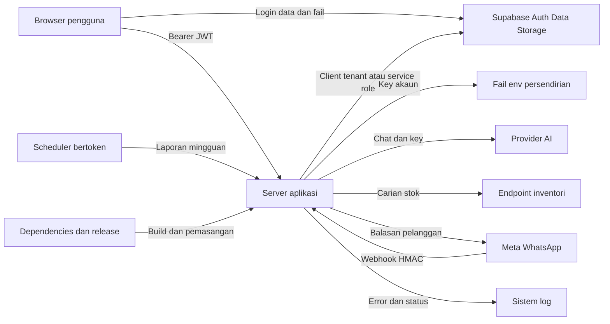

## Executive summary

**DRAF — konteks deployment belum disahkan pengguna.** LokalChat ialah aplikasi React/TanStack Start dengan Supabase Auth/Data API/Storage, orchestrator AI server dan integrasi WhatsApp. Risiko utama yang disokong kod ialah sambungan outbound yang tidak dipinkan kepada DNS tervalidasi, pengembangan dokumen tanpa budget, dan pemindahan maklumat sensitif ke log. RLS dan pengasingan konfigurasi per akaun ialah kawalan utama, tetapi enforcement melalui servis sebenar belum diuji dalam sesi ini. Bukti terperinci dan tahap pengesahan setiap penemuan berada dalam [laporan audit](../SECURITY_AUDIT_2026-11-04.md).

## Scope and assumptions

- Repo yang dinilai ialah `/home/irsyad_b/lokalchat-open`, HEAD `054ffa7` berserta working tree belum commit. Salinan app lain, OS laptop dan infrastruktur hosting tidak termasuk.
- Setiap pemilik kedai ialah tenant berasingan; akaun biasa tidak patut membaca atau membelanjakan key tenant lain. Admin pemasangan dan operator server dianggap dipercayai.
- Chat pelanggan, nombor telefon, dokumen, key AI dan credentials WhatsApp ialah aset sensitif. Provider AI serta Meta ialah pihak luar yang menerima data mengikut fungsi produk.
- Penilaian priority mengandaikan sasaran internet dengan beberapa pengguna tidak saling dipercayai. Konfigurasi lokal yang ditemui menggunakan loopback; itu tidak membuktikan ketiadaan deployment lain.
- Semakan source, mock dan schema sementara tidak mengesahkan state production. Tiada serangan ke endpoint pelanggan, penghantaran mesej sebenar atau fixtures pada database pengguna dibuat.

Soalan yang telah dihantar dan masih terbuka: adakah penggunaan hanya peribadi pada laptop, sasaran internet multi-user, atau production yang sudah aktif? Jawapan itu diperlukan untuk memuktamadkan criticality. Sempadan data/log provider dan polisi retention juga belum diketahui.

## System model

### Primary components

| Komponen | Peranan | Evidence anchor |
| --- | --- | --- |
| Browser React | Auth, dashboard, upload, Settings dan cache per akaun | `src/routes/_authenticated/route.tsx:53`, `src/integrations/supabase/client.ts:47` |
| TanStack server functions | 34 operasi owner/admin dengan middleware Auth | `src/lib/lokalchat.functions.ts:33`, `src/integrations/supabase/auth-middleware.ts:33` |
| Supabase | Auth JWT, jadual tenant, Storage persendirian dan polisi RLS | `supabase/migrations/20260816002950_794c52a2-e847-4683-aa22-bd0d4c78e78d.sql:5`, `supabase/migrations/20261024090600_create_kb_storage_bucket.sql:3` |
| Agent AI | Sejarah chat, FAQ, inventori, handoff dan persistence balasan | `src/lib/agent.server.ts:229`, `src/lib/agent.server.ts:288` |
| Fail konfigurasi | Env per UUID dan projek Auth, key server untuk enkripsi WhatsApp | `src/lib/env-file.server.ts:7`, `src/lib/wa-crypto.server.ts:7` |
| Webhook dan cron hook | HMAC WhatsApp inbound serta token laporan mingguan | `src/routes/api/public/whatsapp.ts:43`, `src/routes/api/public/hooks/weekly-report.ts:33` |
| Installer/build | Salinan template, checksum CLI, npm/pnpm dan build server/client | `packages/create-lokalchat/scripts/prepare-template.mjs:9`, `scripts/local/download.mjs:90` |

### Data flows and trust boundaries

- Browser kepada Supabase Auth/Data API/Storage: credentials, JWT, fail dan metadata melalui HTTP loopback atau HTTPS hosted. Auth serta RLS/Storage policies memberi kawalan; browser mempunyai akses token dan tidak boleh dianggap trusted.
- Browser kepada server function: input operasi dan Bearer JWT. Middleware memanggil `getClaims`; aplikasi menggunakan client RLS dan mengasingkan key berdasarkan identiti context. Beberapa validator masih type assertion tanpa schema penuh.
- Server kepada database melalui service role: chat, credentials dan operasi delivery privileged. RLS dibypass secara sengaja; pemilik mesti datang daripada lookup server, bukannya input yang belum disahkan.
- Server kepada fail env: UUID sah dan namespace Auth menentukan path. Direktori/fail baharu menggunakan 0700/0600, lock dan penolakan symlink. Key AI disimpan dalam plaintext persendirian; enkripsi disk/backup ialah tanggungjawab operator.
- Server kepada provider AI/inventori: sejarah chat, prompt/FAQ dan key AI melalui endpoint pilihan pemilik; inventori membenarkan HTTP(S). Redirect gateway/inventori ditolak, tetapi resolver sambungan tidak terikat kepada DNS yang disemak.
- Meta kepada webhook: JSON dan HMAC badan mentah. Tenant dipilih menggunakan phone ID dalam connection server; penulisan berlaku selepas HMAC sah. Badan dibuffer sebelum verifikasi.
- Scheduler kepada weekly hook: token rahsia dibanding secara constant-time. Hook merentas tenant menggunakan service role dan menghormati opt-out pengguna.
- Runtime kepada log: status, error/cause dan sebahagian kandungan provider/simulator. Tiada redaction menyeluruh ditemui; retention dan akses log luar belum diketahui.
- Mesin developer kepada dependency/release upstream: muat turun HTTPS dan lifecycle packages. CLI bootstrap mempunyai checksum; manifest installer mengecualikan env/log/runtime. Tiada CI release aktif disahkan dalam skop.

#### Diagram

## Assets and security objectives

| Asset | Why it matters | Security objective |
| --- | --- | --- |
| Chat dan nombor pelanggan | Pendedahan PII dan perbualan perniagaan | C/I |
| Dokumen dan FAQ | Maklumat komersial dan ketepatan jawapan | C/I |
| Key AI/Supabase/WhatsApp | Akses data, impersonation dan kos API | C/I |
| Peranan admin dan pemilikan tenant | Menentukan sempadan semua data | C/I |
| Worker, RAM, database dan quota | Sumber dikongsi merentas pengguna | A |
| Log dan backup | Boleh menyalin data sensitif ke sistem lain | C/I |
| Lockfile dan installer | Integriti kod yang dijalankan pengguna | C/I/A |

## Attacker model

### Capabilities

Penyerang internet boleh menghantar request ke route awam jika server terdedah. Pengguna biasa yang berniat jahat boleh memanggil API secara terus, memuat naik fail miliknya, menukar endpoint sendiri dan mengawal domain DNS. Pelanggan WhatsApp boleh menghantar mesej yang sampai melalui webhook Meta sah. Provider atau endpoint inventori yang tidak dipercayai boleh memulangkan kandungan arbitrari.

### Non-capabilities

Penyerang tidak diandaikan memiliki key service-role, key enkripsi, akses shell atau akses tulis ke direktori operator. Penyerang tidak boleh dianggap mampu memalsukan JWT/HMAC yang sah tanpa mendapatkan key. Mereka tidak boleh memilih `businessId` arbitrari melalui tool AI; ID itu ditentukan kod. Akses admin lintas tenant yang disengajakan bukan dianggap kebocoran kepada pengguna biasa.

## Entry points and attack surfaces

| Surface | How reached | Trust boundary | Notes | Evidence |
| --- | --- | --- | --- | --- |
| Login/signup | Browser ke Auth | Internet kepada Auth | Polisi CAPTCHA/MFA/expiry live belum diketahui | `src/routes/auth.tsx:32` |
| 34 server functions | RPC TanStack | Browser kepada server | Semuanya mempunyai middleware Auth | `src/lib/lokalchat.functions.ts:33` |
| Data API dan Storage | SDK browser terus | Browser kepada database/file service | RLS/grant wajib berfungsi walaupun UI dibypass | `src/integrations/supabase/client.ts:47` |
| Upload/extraction | Storage dan process function | Data tenant kepada parser server | Had compressed sahaja belum cukup | `src/lib/lokalchat.functions.ts:671` |
| WhatsApp GET/POST | Route awam | Meta/Internet kepada server | HMAC sebelum ingestion; body dibuffer lebih awal | `src/routes/api/public/whatsapp.ts:13` |
| Weekly report | Route awam bertoken | Scheduler kepada operasi privileged | Token server serta dedupe masa | `src/routes/api/public/hooks/weekly-report.ts:29` |
| Inventori/custom LLM | Konfigurasi tenant | Server kepada destinasi luar | Risiko SSRF melalui DNS | `src/lib/agent.server.ts:127` |
| Logging | Ralat provider/simulator | Data runtime kepada log | Kandungan sensitif boleh disalin | `src/lib/embeddings.server.ts:30` |
| Installer | CLI developer | Supply chain kepada host pengguna | Checksum CLI, template allowlist, lockfiles | `scripts/local/download.mjs:97` |

## Top abuse paths

1. **Capaian dalaman melalui DNS:** akaun biasa menetapkan inventori miliknya; DNS lulus DoH; resolver sambungan memberi alamat lain; hasil dalaman boleh sampai semula ke balasan chat. Memerlukan egress yang membenarkannya; belum dieksploit secara live.
2. **Gangguan proses melalui dokumen:** pengguna upload DOCX kecil; extractor mengembangkan entri tanpa budget; RAM/CPU proses bersama meningkat. Probe 12 MiB membuktikan saiz hasil tidak dihadkan oleh had upload.
3. **Salinan rahsia dalam log:** provider memantulkan data sensitif dalam error body; logger menyimpan body/cause; akses log atau eksport log membuka salinan data itu. Probe penanda sintetik mengesahkan sink.
4. **Penggunaan sumber berulang:** akaun biasa memanggil processing/simulator serentak; tiada claim/quota aplikasi; worker/database/provider terus digunakan. Had edge dan provider menentukan skala sebenar.
5. **Kesan XSS meningkat:** jika penyerang menemui XSS lain, token localStorage boleh diambil; CSP yang tiada pada handler tidak memberi lapisan tambahan. Audit ini tidak menemui exploit XSS tersebut.
6. **Token dicuri kekal berguna:** token masih belum luput selepas logout; middleware mengesahkan claims tanpa syarat sesi aktif; perubahan key masih berpotensi dilakukan. Bergantung pada jenis pengesahan Auth dan polisi expiry.
7. **Drift deployment membuka data:** migration atau grant production berbeza daripada source; penyerang memanggil Data API terus. Ini hipotesis deployment yang belum diuji, bukan penemuan kebocoran source.

## Threat model table

| Threat ID | Threat source | Prerequisites | Threat action | Impact | Impacted assets | Existing controls (evidence) | Gaps | Recommended mitigations | Detection ideas | Likelihood | Impact severity | Priority |
| --- | --- | --- | --- | --- | --- | --- | --- | --- | --- | --- | --- | --- |
| TM-001 | Tenant berniat jahat | Akaun dan domain inventori; rangkaian dalaman boleh dicapai | Menukar jawapan DNS selepas/berbeza daripada semakan | SSRF dan kemungkinan exfiltration dalaman | Data/key dalaman | Private literal dan redirect ditolak; `ssrf.server.ts:63` | A sahaja, sambungan tidak dipinkan | Validasi semua alamat, pin lookup, egress firewall | Log destinasi/IP tanpa payload, alert private egress | medium | high | high |
| TM-002 | Tenant upload | Akaun sah dan dokumen mampat | Mengembangkan data besar dalam proses aplikasi | Gangguan semua pengguna proses | RAM/CPU/availability | Had Storage 10 MiB; `lokalchat.functions.ts:704` | Tiada budget hasil/worker | Streaming limit dan worker terhad | Metrik masa extraction dan expansion ratio | high | high | high |
| TM-003 | Provider atau input sensitif | Ralat atau dry-run dicatat | Menyalin kandungan sensitif ke log | Luas akses dan retention data meningkat | Key/chat/PII | Ralat send WhatsApp disaring; `whatsapp.server.ts:128` | Laluan AI/simulator masih raw | Logger berstruktur dan redaction | Canary sintetik dalam ujian log, audit akses log | medium | medium | medium |
| TM-004 | Internet/tenant berulang | Endpoint boleh dicapai | Request besar atau kerja serentak/berulang | Sumber habis dan kos meningkat | Worker/database/quota | Auth dan timeout sebahagian; `agent.server.ts:134` | Quota, limit body/stream dan timeout embedding tiada | Budget per operasi dan tenant, claim processing | Concurrency, byte count, quota alerts | medium | medium | medium |
| TM-005 | Penyerang browser | Memerlukan XSS lain atau framing yang relevan | Menyalah guna token/aksi UI | Kompromi akaun | Session/key/data tenant | Escaping React dan origin broker; `ChatWindow.tsx:73` | Header handler tidak memberi CSP/framing defense | Polisi header diuji di edge/app; semak storage sessions | CSP reports dan ujian header | low | high | medium |
| TM-006 | Pemegang JWT curi | Token sah belum luput | Bertindak selepas logout | Tempoh kompromi berlanjutan | Konfigurasi/data akaun | JWT diverifikasi; `auth-middleware.ts:92` | Tiada jaminan immediate revocation | Semakan session untuk operasi sensitif dan polisi expiry | Rekod perubahan key tanpa log key, sesi/IP luar biasa | low | medium | low |
| TM-007 | Pemanggil Data API | Deployment drift atau polisi belum diterapkan | Memintas UI dan membaca row/file tenant lain | Kebocoran lintas tenant | Semua data tenant | Source RLS/grants telah diketatkan; migration akhir | State live dan Realtime belum diuji | Ujian A/B/anon pada stack disposable dan advisor live yang sepadan | Policy drift checks dan audit akses | low | high | high |
| TM-008 | Supply chain | Dependency terjejas masuk release | Kod pihak ketiga berjalan semasa install/runtime | Kompromi host dan credentials | Host/build/key | Lockfiles, checksum CLI, template allowlist | Full advisory registry scan terhalang | Advisory scan lengkap dan install reproducible | Pin/provenance review dan pemantauan advisory | low | high | medium |

TM-007 ialah risiko bersyarat yang masih terbuka; priority tinggi menentukan keutamaan pengesahan, bukan dakwaan ada leak. TM-008 juga bukan penemuan malware. Versi TanStack semasa melepasi tiga advisory yang disemak dan tiada indikator khusus ditemui dalam 25 manifest semasa.

## Criticality calibration

- **Critical:** bacaan semua data tenant tanpa Auth; pendedahan service-role kepada client; execution arbitrari pada server daripada request awam. Tiada kes tersebut dibuktikan dalam audit ini.
- **High:** SSRF kepada servis dalaman pada host multi-user; parser satu tenant boleh mengganggu proses bersama; drift RLS yang benar-benar membuka data tenant lain.
- **Medium:** maklumat sensitif memasuki log berakses terhad; request budget tidak menyeluruh; security header aplikasi tidak disediakan ketika edge belum disahkan.
- **Low:** perbezaan semantik logout berbanding pembatalan serta-merta; polisi retention yang belum didokumenkan; peluang hardening yang memerlukan kompromi lain terlebih dahulu.

Konteks loopback peribadi menurunkan likelihood penyerang internet. Ia tidak mengubah bukti bahawa extraction tidak dibudget atau bahawa raw provider body boleh mencapai log.

## Focus paths for security review

| Path | Why it matters | Related Threat IDs |
| --- | --- | --- |
| `src/lib/ssrf.server.ts` | Pengesahan URL/DNS | TM-001 |
| `src/lib/agent.server.ts` | Egress, tool boundaries dan body/logging | TM-001, TM-003, TM-004 |
| `src/lib/kb-extract.server.ts` | Decompression dan workload parser | TM-002 |
| `src/lib/lokalchat.functions.ts` | Auth, pemilikan, upload dan operasi privileged | TM-001, TM-002, TM-004, TM-006 |
| `src/lib/embeddings.server.ts` | Key provider, timeout dan log response | TM-003, TM-004 |
| `src/integrations/supabase/auth-middleware.ts` | Verifikasi JWT dan semantik sesi | TM-006 |
| `src/lib/env-file.server.ts` | Pengasingan fail credentials | TM-003, TM-006 |
| `src/routes/api/public/whatsapp.ts` | HMAC, body limit dan pemilihan tenant | TM-004, TM-007 |
| `src/routes/api/public/hooks/weekly-report.ts` | Hook service-role merentas tenant | TM-003, TM-007 |
| `src/server.ts` dan `vite.config.ts` | Respons handler dan konfigurasi production | TM-005 |
| `src/integrations/supabase/previewAuthStorage.ts` | Session browser dan broker preview | TM-005 |
| `supabase/migrations/` | RLS, ACL, role guard, RPC dan Storage | TM-006, TM-007 |
| `packages/create-lokalchat/` dan `scripts/local/` | Integriti template dan bootstrap | TM-008 |
| `package-lock.json` dan `pnpm-lock.yaml` | Tree dependencies release | TM-008 |

## Notes on use

- Semua surface yang ditemui, sempadan utama dan perbezaan runtime/build telah dipetakan. Laluan provider tidak memberi tool arbitrari atau akses shell kepada model.
- Ujian live RLS, quota, Auth signout/replay, Realtime, TLS/edge dan advisory semua dependencies masih terbuka. Mod PostgreSQL single-user tidak digunakan untuk mendakwa RLS lulus atau gagal.
- Finalisasi draf memerlukan jawapan konteks pengguna. [Skill security-threat-model](../../../.agents/skills/security-threat-model/SKILL.md) menetapkan: “Pause and wait for user feedback before producing the final report.”
- Gunakan draf untuk mengutamakan semakan/pembaikan, bukan sebagai sijil keselamatan, bukti leak yang telah berlaku atau bukti bahawa production sudah diperiksa.
